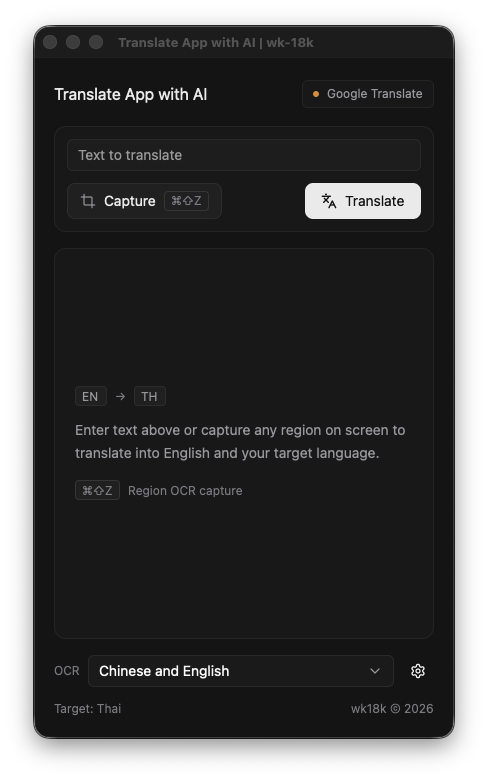

<p align="center"></p>

# Language Translation App with AI (Rust + GPUI Kit)

A fast, native desktop translation utility rewritten in **Rust** with **[gpui-kit](https://github.com/longbridge/gpui-kit)**, featuring fullscreen drag-capture OCR and bilingual translation (English bridge + customizable target language) powered by modern AI providers or Google Translate.

<p align="center">
  
  
</p>

## Features

- **Native GPU-Accelerated Desktop UI:** Built with Rust and `gpui-kit` (`0.10.0`), featuring a quiet Graphite dark interface, bilingual two-tier translation sheet (`EN` → target language), one-click copy, and searchable target language picker (100+ languages).
- **Fullscreen Drag-Capture OCR (`⌘⇧Z` / `Ctrl+Shift+Z`):** Click **Capture** or press the shortcut to freeze the screen, drag a rectangle over any text, crop to `orc.png`, extract text via `tesseract` (or macOS Vision fallback), and copy automatically to the clipboard and input field.
  - Supported OCR language packs: **Chinese and English**, **Thai and English**, **Turkish and English**.
- **Modern Translation Engines (Configurable In-App):**
  - **Google Translate** — Free, instant, no API key required
  - **OpenAI** — Default `gpt-6.2-sol` (supports `gpt-6.2-astra`, `gpt-6.1-terra`, `gpt-6-luna`, etc.)
  - **Google Gemini** — Default `gemini-4-neon` (supports `gemini-4-hydrogen`, `gemini-4-argon`, `gemini-4-carbon`, etc.)
  - **Claude (Anthropic)** — Default `claude-sonnet-5-5` (supports `claude-opus-5-5`, `claude-haiku-5-5`, `claude-fable-5-2`)
  - **DeepSeek** — Default `deepseek-chat` (supports `deepseek-reasoner`)
  - **Ollama (Local AI)** — Free local models (default `gemma4`, also `qwen3.5:9b`, `qwen3.5:4b` at `http://localhost:11434/v1`)
  - **Custom (OpenAI-Compatible API)** — Works with OpenRouter, Groq, LM Studio, Together, vLLM, etc.
- **Persistent Local Configuration:** Enter your provider, model, API key (masked), and base URL directly in the **Settings** dialog. Credentials and last-selected preferences are saved locally in JSON files (excluded from git via `.gitignore`).

## Quick Start

### Prerequisites

- **Rust** (stable toolchain, `cargo`)
- *(Optional for OCR)* **Tesseract OCR** (`brew install tesseract tesseract-lang` on macOS). On macOS, Apple Vision OCR is also used automatically as a fallback.

### Run the App

```bash
cargo run
```

### Build Release Binary

```bash
cargo build --release
```

The compiled binary will be available at `target/release/language-translation-app`.

### Run Unit Tests

```bash
cargo test --lib
```

## Configuration

Open **Settings** by clicking the engine badge in the top-right corner or the gear icon at the bottom-right:

1. Choose your **Translator** provider.
2. Enter the **Model**, **API key** (if required), and **Base URL** (for Ollama or Custom OpenAI-compatible endpoints).
3. Click **Save**.

Settings are stored locally in the working directory:

| File | Purpose |
| --- | --- |
| `app_settings.json` | Last selected translator engine and target language |
| `api_key_chatgpt.json` | OpenAI API key and model |
| `api_gemini.json` | Google Gemini API key and model |
| `api_claude.json` | Anthropic Claude API key and model |
| `api_deepseek.json` | DeepSeek API key and model |
| `ollama_config.json` | Ollama model and local base URL |
| `custom_openai.json` | Custom OpenAI-compatible base URL, model, and API key |

> All API key and local config JSON files are listed in `.gitignore` so secrets are never committed accidentally.

## OCR Drag-Capture

1. Select the OCR script in the bottom dock (`Chinese and English`, `Thai and English`, or `Turkish and English`).
2. Click **Capture** or press **`⌘⇧Z`** (macOS) / **`Ctrl+Shift+Z`** (Windows/Linux).
3. Click and drag over the text region on screen, then release (press **`Esc`** to cancel).
4. Press **Translate** to translate the extracted text.

*(On macOS, grant **Screen Recording** permission when prompted on first capture.)*

## Credit

- Original Python Snipper concept inspired by [textshot](https://github.com/ianzhao05/textshot)
- UI redesign guided by `unslop` by Damir Sokolovsky ([@heydamir](https://x.com/heydamir))

## Changelog

- **2.0 (Rust + GPUI Kit Rewrite):**
  - Rewrote the entire application in Rust using `gpui-kit 0.10.0`
  - Redesigned UI with Graphite dark theme, bilingual two-tier translation sheet, ISO language tags, and shortcut keycaps
  - Rebuilt fullscreen drag-capture OCR overlay natively in GPUI (`SnipperOverlay`) with pure-Rust cropping (`image`) and `tesseract` / macOS Vision OCR
  - Removed retired providers (Bing Chat, Bard, ChatGPT Free proxy)
  - Added modern providers: OpenAI (`gpt-6.2-sol`), Gemini (`gemini-4-neon`), Claude (`claude-sonnet-5-5`), DeepSeek (`deepseek-chat`), Ollama (`gemma4`), and Custom OpenAI-Compatible APIs
  - Added in-app Settings form with masked API key input and persistent local config storage
- **1.2:**
  - Updated Gemini and ChatGPT prompts
  - Removed ChatGPTFREE
  - Added generative AI model selection
- **1.1:**
  - Added support for Gemini
  - Removed Bard API
  - Added Turkish OCR support
- **1.0:**
  - Initial Python (Flet) release
