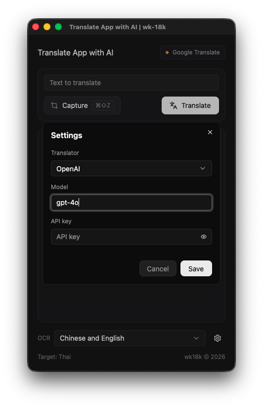

<p align="center"></p>

# Language Translation App with AI (Rust + GPUI Kit)

A fast, 100% pure-Rust desktop translation utility built with **[gpui-kit](https://github.com/longbridge/gpui-kit)**, featuring OS-wide global drag-capture OCR, native Apple Vision & Windows WinRT OCR, built-in ONNX offline OCR (`ocrs`), Vision AI OCR, live streaming translations, floating HUD overlay, voice TTS, clipboard watcher, custom glossary, history export, and OS Keychain credential storage.

<p align="center">
  
  
</p>

## Features

- **Native GPU-Accelerated Desktop UI (`gpui-kit 0.10.0`):**
  - Graphite Dark & Graphite Light palettes (`System / Dark / Light` theme selector) crafted with `unslop` design tokens.
  - Bilingual two-tier translation sheet (`EN` → target language) with inline target language picker (100+ languages), one-click copy, and native **Text-to-Speech (`Volume2`)** on both tiers.
  - Runtime native **Always-on-Top (`Pin`)** toggling on macOS (`NSWindow.setLevel`) and Windows (`SetWindowPos`).
- **OS-Wide Global Hotkey & Multi-Monitor Drag-Capture OCR (`⌘⇧Z` / `Ctrl+Shift+Z`):**
  - Trigger fullscreen region capture from any application (games, manga, PDFs, browsers).
  - **9 OCR language presets:** Auto-detect, Thai, Chinese (Simplified & Traditional), Japanese, Korean, Turkish, Arabic, and Vietnamese.
  - **Accurate Offline OCR Chain:**
    1. **macOS Apple Vision (`VNRecognizeTextRequest`)** — built-in, zero-install, accurate Thai/CJK/Arabic/Latin recognition
    2. **Tesseract CLI** — verified via `tesseract --list-langs` so missing language packs never silently output garbage
    3. **Windows WinRT `Windows.Media.Ocr.OcrEngine`** — built-in on Windows 10/11
    4. **Built-in Pure-Rust ONNX OCR (`ocrs` + `rten`)** — offline fallback using models in `<data_dir>/models`
  - **Vision AI OCR Mode:** Optionally send the cropped image directly to multimodal models (`gemini-4-neon`, `gpt-6.2-sol`, `claude-sonnet-5-5`, `gemma4`) to read and translate in a single request.
  - **Floating HUD Overlay & Auto-Translate:** Optional floating translation popup after OCR capture for fullscreen reading and games.
- **Modern Translation Engines (2026 Lineup, Configurable In-App):**
  - **Google Translate** — Free, instant, no API key required
  - **OpenAI** — Default `gpt-6.2-sol` (`gpt-6.2-astra`, `gpt-6.1-terra`, `gpt-6-luna`)
  - **Google Gemini** — Default `gemini-4-neon` (`gemini-4-hydrogen`, `gemini-4-argon`, `gemini-4-carbon`)
  - **Claude (Anthropic)** — Default `claude-sonnet-5-5` (`claude-opus-5-5`, `claude-haiku-5-5`, `claude-fable-5-2`)
  - **DeepSeek** — Default `deepseek-chat` (`deepseek-reasoner`)
  - **Ollama (Local AI)** — Free local models (default `gemma4`, `qwen3.5:9b`, `qwen3.5:4b` at `http://localhost:11434/v1`)
  - **Custom (OpenAI-Compatible API)** — OpenRouter, Groq, LM Studio, Together, vLLM, etc.
- **Single-Hop Direct AI Translation, Live SSE Streaming & Clipboard Watcher:**
  - Single-hop bilingual JSON mode translates into English and your target language in one API call.
  - UTF-8-safe byte-buffered SSE streaming displays tokens live as they arrive.
  - Optional self-copy-aware **Clipboard Watcher** automatically translates newly copied text.
- **History Export, Glossary Import/Export & OS User Data Directory:**
  - Searchable history (up to 200 entries) with one-click **CSV** and **Markdown** export to `Downloads`.
  - Custom glossary injected into AI prompts, with **CSV/JSON import & export**.
  - All configuration and data stored cleanly in the OS user data directory (`~/Library/Application Support/language-translation-app` on macOS, `%APPDATA%\language-translation-app` on Windows, `~/.config/language-translation-app` on Linux) with automatic migration from legacy working-directory files.
  - API keys stored in **macOS Keychain** / **Windows Credential Manager** (`keyring`).

## Quick Start

```bash
# Run in development
cargo run

# Run all unit & mock-server tests
cargo test --lib

# Build optimized release binary
cargo build --release
```

See [CONTRIBUTING.md](CONTRIBUTING.md) for architecture details and [CHANGELOG.md](CHANGELOG.md) for release history.

## Credit

- Original Python Snipper concept inspired by [textshot](https://github.com/ianzhao05/textshot)
- UI design guided by `unslop` by Damir Sokolovsky ([@heydamir](https://x.com/heydamir))
